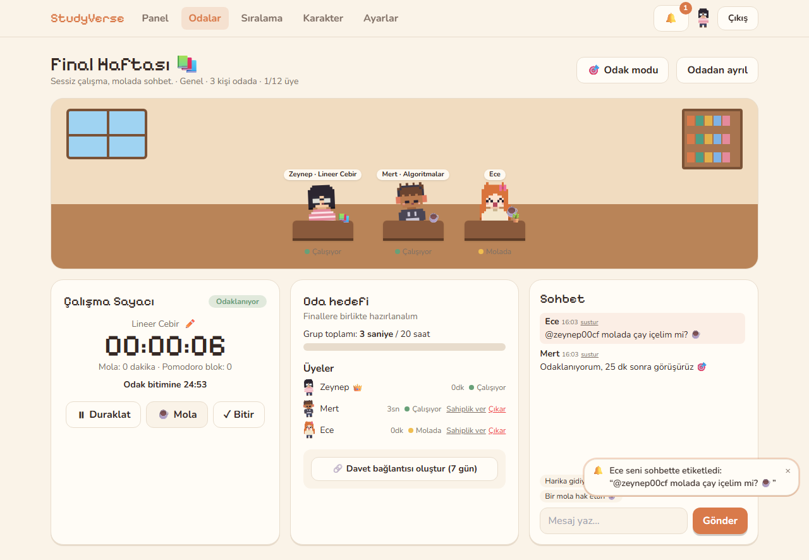
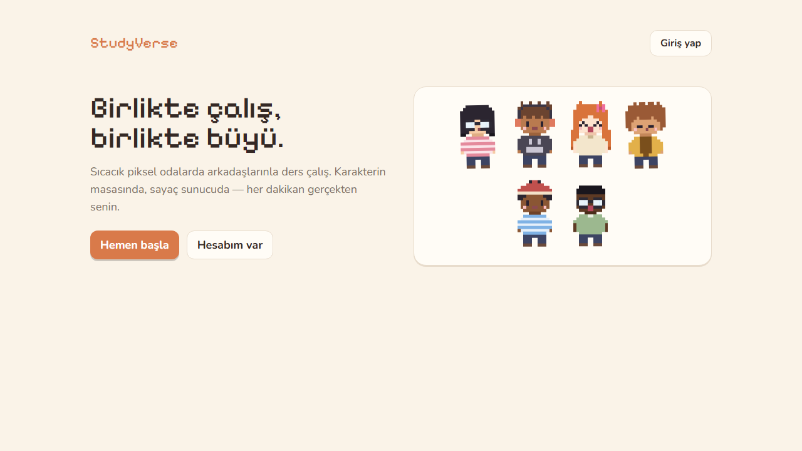
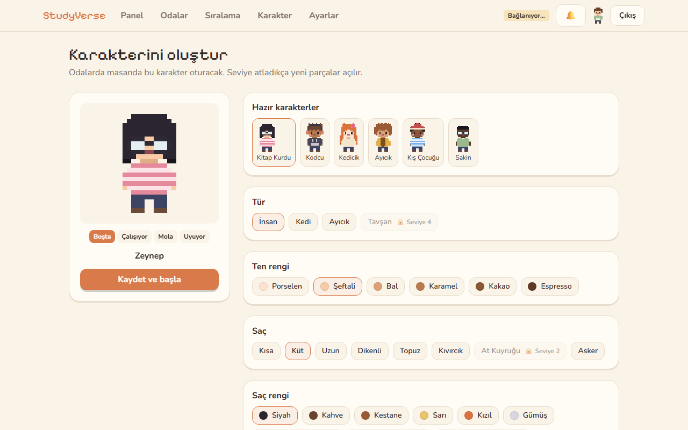
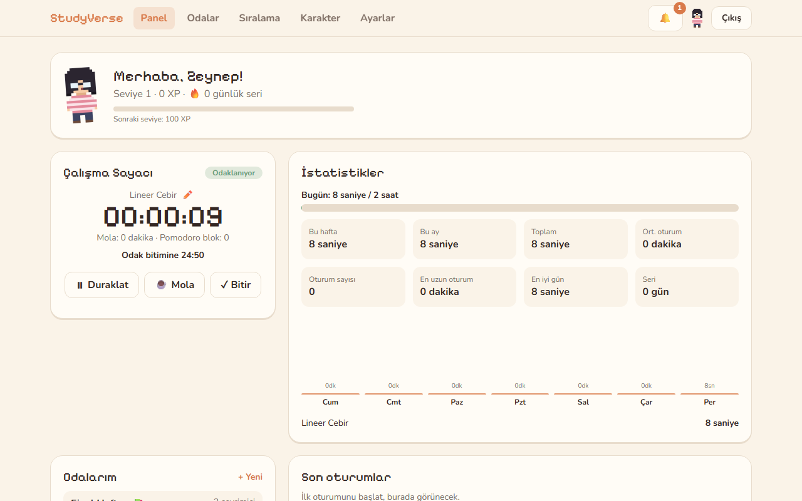
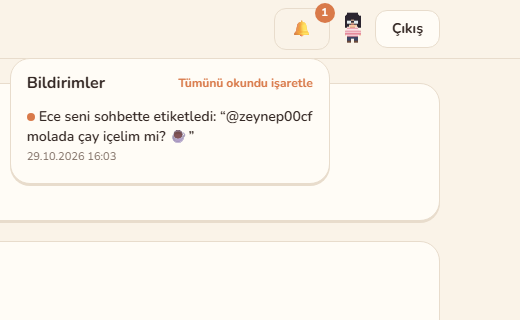
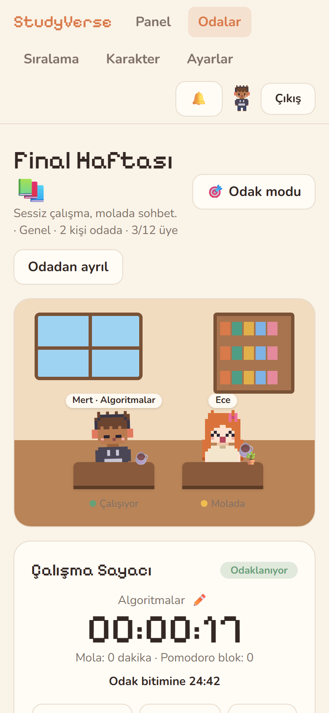

<div align="center">

# 📚 StudyVerse

**Arkadaşlarınla sıcacık piksel odalarda birlikte ders çalış.**
Karakterin masanda oturur, sayaç sunucuda işler — her dakikan gerçekten senin.




</div>

---

## ✨ Özellikler

| | |
|---|---|
| 🏠 **Canlı çalışma odaları** | Herkese açık ya da davetle girilen özel odalar, oda şifresi, kişi sınırı, oda hedefi ve grup ilerlemesi. Oda sahibi üye çıkarabilir ve sahipliği devredebilir. |
| 🧑‍🎨 **Piksel karakterler** | Özgün piksel art: 4 tür, ten tonları, 8 saç modeli, kıyafetler, aksesuarlar ve masa eşyaları. Karakter çalışırken, moladayken ve boştayken farklı görünür. |
| ⏱️ **Sunucu doğrulamalı sayaç** | Başlat, duraklat, mola ve bitir. Süreyi sunucu hesaplar; cihaz saatini değiştirmek bir şey değiştirmez. Duraklatılan süre sayılmaz, aynı anda iki oturum açılamaz. |
| 🍅 **Pomodoro** | Ayarlanabilir odak ve mola süreleri, isteğe bağlı otomatik geçiş, sesli ve tarayıcı bildirimi. |
| ✏️ **Oturumda konu değiştirme** | Sayacı durdurmadan çalıştığın konuyu değiştirirsin. Önceki süre eski konuda kalır, odadakiler değişikliği anında görür. |
| 🔔 **Gerçek zamanlı bildirimler** | Oda içi giriş, çıkış, çalışma ve mola bildirimleri. `@etiket` bildirimleri kalıcıdır; çevrimdışıyken gelenleri sonra okursun. Okunmamış sayacı olan bir zil var. |
| 🔊 **Ses tercihleri** | Genel anahtar ve 5 ayrı kategori. Sesler Web Audio ile üretilir, ses dosyası yoktur. |
| 💬 **Oda sohbeti** | Uzunluk sınırı, hız sınırı, tekrar mesaj engeli, susturma ve hazır motivasyon mesajları. |
| 📊 **İstatistikler** | Bugün, hafta, ay ve toplam süre; seri, 7 günlük grafik, konu bazında dağılım, kişisel rekorlar ve oturum geçmişi. |
| 🏆 **XP ve sıralama** | Seviyeler, 15 başarım, açılan kozmetikler, haftalık ve tüm zamanlar sıralaması. |
| 🌗 **Tema ve erişilebilirlik** | Açık ve koyu tema, klavyeyle gezinme, ARIA etiketleri, `prefers-reduced-motion` desteği, mobil uyum. |

## 📸 Ekran görüntüleri

<table>
  <tr>
    <td width="50%"><br/><sub>Karşılama</sub></td>
    <td width="50%"><br/><sub>Karakter oluşturma</sub></td>
  </tr>
  <tr>
    <td><br/><sub>Panel: sayaç, istatistikler, son oturumlar</sub></td>
    <td><br/><sub>Kalıcı etiket bildirimleri</sub></td>
  </tr>
  <tr>
    <td colspan="2" align="center"><br/><sub>Mobil</sub></td>
  </tr>
</table>

## 🧱 Mimari

```
studyverse/
├── shared/   # avatar kataloğu + piksel çizici, XP/seviye kuralları, süre biçimlendirme
├── server/   # Express 5 · Socket.IO · Prisma · Zod · Argon2id · JWT
│   ├── prisma/          # şema + migration'lar
│   └── src/
│       ├── auth/        # token'lar, middleware, CSRF
│       ├── routes/      # REST API
│       ├── services/    # oturum ve istatistik iş mantığı
│       └── realtime/    # socket sunucusu, presence, oda olayları
├── client/   # Vite · React 18 · Tailwind · TanStack Query
└── e2e/      # tarayıcı testleri (Playwright)
```

**Öne çıkan tasarım kararları**

- **Kimlik doğrulama**
  - 15 dakikalık JWT, HttpOnly + SameSite cookie içinde.
  - Yenileme token'ı her kullanımda değişir. Eski bir token tekrar kullanılırsa o oturum ailesinin tamamı iptal edilir.
  - Çıkış anında geçerli olur; her istekte oturumun iptal edilip edilmediği kontrol edilir.
  - CSRF koruması: özel bir istek başlığı ve izinli Origin kontrolü.
- **Süre takibi**
  - Bir oturum, sunucu zaman damgalı segmentlerden oluşur (`FOCUS` / `BREAK`); duraklama iki segment arasındaki boşluktur.
  - İstemci hiçbir zaman süre göndermez. Kullanıcı başına tek açık oturumu veritabanındaki bir unique kısıt garanti eder; durum değişiklikleri satır kilidi (`FOR UPDATE`) altında yapılır.
  - Konu ya da oda değişince segment bölünür, böylece süreler doğru konuya ve odaya yazılır.
  - Süreler milisaniye cinsinden toplanıp yalnızca en sonda yuvarlanır.
- **Eski oturum kuralı**: 10 dakika heartbeat gelmezse oturum son heartbeat anında duraklatılır. 12 saat duraklı kalan oturum otomatik bitirilir.
- **XP**
  - Yalnızca sunucuda hesaplanır: dakika başına 1 XP, 25 dakika ve üzeri oturuma +10, pomodoro bloğu başına +5. 5 dakikadan kısa oturum XP kazandırmaz, günlük üst sınır 800 XP'dir.
  - Her ödül benzersiz bir kayıtla tutulduğu için yalnızca bir kez alınabilir.
- **Bildirimler**
  - Oda olaylarını yalnızca sunucu üretir. Sadece o an odada olanlara gider, işlemi yapana gitmez.
  - Her olayın benzersiz bir kimliği vardır; yeniden bağlanınca eski olaylar tekrar oynatılmaz.
  - Sayfa yenileme "ayrıldı / katıldı" bildirimi üretmez (8 saniyelik bekleme süresi).
- **Ölçeklenme**: `REDIS_URL` verilirse Socket.IO Redis adapter'ı ve paylaşılan presence deposu devreye girer.

## 🚀 Kurulum

Gereksinimler: **Node.js 22+** ve **Docker** (PostgreSQL ile Redis için).

```bash
git clone https://github.com/yahyaberke/studyverse.git
cd studyverse
cp .env.example .env
# .env içindeki JWT_ACCESS_SECRET'ı değiştir:
#   node -e "console.log(require('crypto').randomBytes(48).toString('base64url'))"

npm install
npm run db:up        # PostgreSQL :5433 + Redis :6380
npm run db:migrate   # veritabanı şemasını kurar
npm run dev          # API :4000 · arayüz http://localhost:5173
```

## 🧪 Testler

```bash
npm run typecheck    # 3 paketin TypeScript kontrolü
npm run lint         # ESLint
npm test             # API + WebSocket senaryoları (gerçek DB, 3 hesap, eş zamanlı socket'ler)
npm run test:ui      # iki tarayıcıda iki kullanıcıyla arayüz testi
```

`npm test` ve `npm run test:ui` çalışan bir sunucuya bağlanır; önce `npm run dev`'i başlat.

Test edilenler arasında şunlar var: kimlik doğrulama, CSRF, kilitli kozmetikler, oda kapasitesi, özel oda + şifre, iki kullanıcı arasında canlı durum, oturum geçişleri, aynı anda gelen istekler, sohbet doğrulaması, etiket bildirimleri, ses tercihleri ve konu değiştirme.

## 🌍 Production

```bash
npm run build
npm --workspace server run migrate:deploy
NODE_ENV=production COOKIE_SECURE=true CLIENT_ORIGIN=https://alanadin.com npm start
```

- Express, derlenmiş arayüzü (`client/dist`) aynı adresten sunar; cookie'ler ve WebSocket CORS gerektirmeden çalışır.
- HTTPS arkasında `COOKIE_SECURE=true` kullan ve güçlü bir `JWT_ACCESS_SECRET` ver.
- Birden fazla sunucu çalıştıracaksan `REDIS_URL` ayarla. HTTP hız sınırları için de paylaşılan bir depo gerekir (örneğin `rate-limit-redis`).
- Şifre sıfırlama e-postası için `MAIL_TRANSPORT=smtp` ve SMTP bilgilerini gir. `console` modu yalnızca geliştirme içindir ve production'da reddedilir.

Bilgisayarından hızlıca paylaşmak için ücretsiz Cloudflare tüneli kullanabilirsin:

```bash
cloudflared tunnel --url http://localhost:4000   # verdiği https://….trycloudflare.com adresini CLIENT_ORIGIN yap
```

## 🗺️ Yol haritası

- [ ] Arkadaşlık sistemi arayüzü ve API'si (veritabanı tabloları hazır)
- [ ] Ortak oda Pomodoro zamanlayıcısı
- [ ] Oda takvimi, kişisel notlar, görev listesi, ortam sesleri
- [ ] Şifre sıfırlama sayfası ve e-posta doğrulama
- [ ] Profil sayfaları ve gizlilik ayarlarının uygulanması
- [ ] Vitest birim testleri

## 🎨 Görseller

Tüm piksel karakterler ve oda görselleri bu proje için özgün olarak çizildi. Sesler Web Audio API ile tarayıcıda üretilir.
